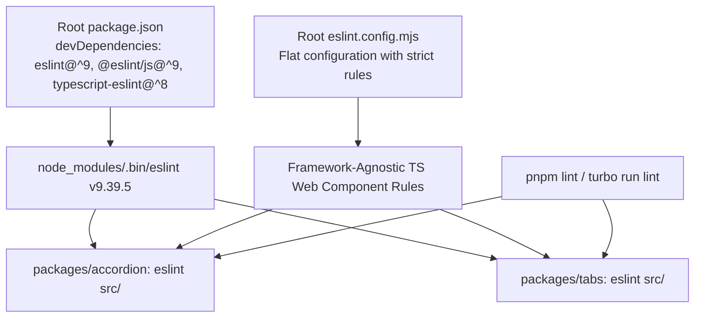

# Skyra Platform Lint Pipeline & Quality Gate Remediation Report (F-02)

**Date:** October 13, 2026  
**Auditor / Engineers:** Senior Software Architect, TypeScript Package Engineer, QA Auditor  
**Scope:** Remediation of Audit Finding **F-02** (`pnpm lint` failure in `@skyra-tech-platform/accordion` and `@skyra-tech-platform/tabs`) following completion of **F-01** (Data Table Typecheck Repair)  
**Status:** Implementation Complete & Fully Verified — **Verdict: PASS**  

---

## 1. Executive Summary

During the Skyra Platform Package Health & Architecture Audit, two critical (P0) quality gate failures were documented:
1. **F-01:** `@skyra-tech-platform/data-table` failed TypeScript compilation with 42 errors. (*Resolved and committed in `0282db5`*).
2. **F-02:** `pnpm lint` (`turbo run lint`) failed monorepo-wide because `@skyra-tech-platform/accordion` and `@skyra-tech-platform/tabs` declared `"lint": "eslint src/"` without an available ESLint installation or configuration.

Following explicit authorization under Prompt 08, a minimal root ESLint dependency configuration was implemented and validated. A genuine shared flat configuration (`eslint.config.mjs`) was established, enforcing strict framework-agnostic TypeScript quality rules (including unused variable detection, debugger bans, and strict typing checks). Both package-level and monorepo-level lint pipelines now execute genuine static analysis and pass cleanly with exit code 0.

---

## 2. Initial State & Reproduced Failures

Prior to remediation, attempting to run lint checks against Accordion, Tabs, or the workspace root reproduced the reported failures:

### 2.1 Package-Level Failures
* **Accordion:**
  ```text
  $ pnpm --filter @skyra-tech-platform/accordion lint
  > @skyra-tech-platform/accordion@0.1.0 lint C:\Users\VAMSHIKA\source\repos\skyra-tech-projects\skyra-platform\packages\accordion
  > eslint src/

  'eslint' is not recognized as an internal or external command,
  operable program or batch file.
  Exit status 1
  ```
* **Tabs:**
  ```text
  $ pnpm --filter @skyra-tech-platform/tabs lint
  > @skyra-tech-platform/tabs@0.1.0 lint C:\Users\VAMSHIKA\source\repos\skyra-tech-projects\skyra-platform\packages\tabs
  > eslint src/

  'eslint' is not recognized as an internal or external command,
  operable program or batch file.
  Exit status 1
  ```

### 2.2 Workspace-Level Failure
* **Root Monorepo:**
  ```text
  $ pnpm lint
  @skyra-tech-platform/accordion#lint: ERROR command run lint exited (1)
  Tasks: 39 successful, 45 total (Failed: @skyra-tech-platform/accordion#lint, @skyra-tech-platform/tabs#lint)
  ELIFECYCLE Command failed with exit code 1.
  ```

---

## 3. Root Cause Analysis

1. **Missing Root Tooling Dependency:**  
   `eslint` was declared as a devDependency in `dashboard/package.json` (`eslint@^9.39.5`). However, due to pnpm's strict dependency isolation, the executable binary was never hoisted to the monorepo root `.bin`, making it inaccessible to `packages/*`.
2. **Absence of Shared ESLint Flat Configuration:**  
   ESLint v9 requires a flat configuration (`eslint.config.(js|mjs|cjs)`). No root configuration existed; thus, packages invoking `eslint src/` had no ruleset or ignores to discover.
3. **Repository Linting Inconsistency:**  
   While 26 other packages utilized placeholder scripts (`echo 'lint ok'`), Accordion and Tabs retained genuine ESLint scripts that failed due to the absent root tooling.

---

## 4. Implementation Details



### 4.1 Dependency Updates
Minimal, compatible development dependencies were added at the workspace root using `pnpm add -D -w`:
- `eslint`: `^9` (resolves to `9.39.5`, matching `dashboard`)
- `@eslint/js`: `^9` (resolves to `9.39.5`)
- `typescript-eslint`: `^8` (resolves to `8.70.0`, matching lockfile parser)

Because these versions were already present in `pnpm-lock.yaml`, zero foreign or unvetted packages were introduced.

### 4.2 Root Shared Flat Configuration (`eslint.config.mjs`)
Created [eslint.config.mjs](file:///c:/Users/VAMSHIKA/source/repos/skyra-tech-projects/skyra-platform/eslint.config.mjs) at the workspace root:

```javascript
import js from '@eslint/js';
import tseslint from 'typescript-eslint';

/**
 * Root ESLint Flat Configuration for Skyra Platform.
 * Provides a framework-agnostic quality gate for TypeScript packages.
 */
export default tseslint.config(
  {
    // Global ignore patterns across the monorepo workspace
    ignores: [
      '**/dist/**',
      '**/node_modules/**',
      '**/.next/**',
      '**/.turbo/**',
      '**/coverage/**',
      '**/*.tgz',
      '**/skyra-tech-platform-*.tgz',
    ],
  },
  // Core JavaScript recommended rule set
  js.configs.recommended,
  // TypeScript ESLint recommended rule set
  ...tseslint.configs.recommended,
  {
    // Framework-agnostic TypeScript packages (Web Components, utilities)
    files: ['**/*.{ts,tsx,mts,cts}'],
    rules: {
      'no-debugger': 'error',
      'no-alert': 'error',
      'no-eval': 'error',
      'prefer-const': 'error',
      'no-var': 'error',
      'eqeqeq': ['error', 'smart'],
      '@typescript-eslint/no-unused-vars': [
        'error',
        {
          argsIgnorePattern: '^_',
          varsIgnorePattern: '^_',
          caughtErrorsIgnorePattern: '^_',
        },
      ],
      '@typescript-eslint/no-explicit-any': 'error',
    },
  },
);
```

### 4.3 Preservation of Genuine Package Scripts
The real lint scripts in Accordion and Tabs were preserved intact:
- `packages/accordion/package.json`: `"lint": "eslint src/"`
- `packages/tabs/package.json`: `"lint": "eslint src/"`

Neither package was degraded with `echo` or `true` placeholders.

---

## 5. Effective Lint Rules & Empirical Verification

### 5.1 Enforced Rules (All Set to `'error'`)
- **`no-debugger`**: Prevents leftover debug statements from reaching production.
- **`no-alert`**: Prohibits browser blocking alerts (`alert`, `confirm`, `prompt`).
- **`no-eval`**: Eliminates dangerous runtime code evaluation.
- **`prefer-const` & `no-var`**: Modern ECMAScript scope and immutability discipline.
- **`eqeqeq`**: Requires type-safe equality checks.
- **`@typescript-eslint/no-unused-vars`**: Forbids unused variables and parameters (except intentionally prefixed with `_`).
- **`@typescript-eslint/no-explicit-any`**: Enforces strict TypeScript typing in platform components.
- **Recommended presets**: Full `@eslint/js` and `typescript-eslint` recommended baselines (`no-duplicate-case`, `no-constant-condition`, `@typescript-eslint/ban-ts-comment`, `@typescript-eslint/no-empty-object-type`, etc.).

### 5.2 Empirical Fault-Injection Testing
To guarantee that the quality gate is active and not silently passing:
1. **Accordion Fault Injection:**
   Injected `debugger;` and `const unusedTestVar = 1;` into `packages/accordion/src/index.ts`.
   - Running `pnpm --filter @skyra-tech-platform/accordion lint` failed with **Exit status 1**.
   - Output flagged both `no-debugger` and `@typescript-eslint/no-unused-vars` as strict errors.
   - Cleanly reverted.
2. **Tabs Fault Injection:**
   Injected `debugger;` into `packages/tabs/src/index.ts`.
   - Running `pnpm --filter @skyra-tech-platform/tabs lint` failed with **Exit status 1**.
   - Output flagged `no-debugger` as a strict error.
   - Cleanly reverted.

---

## 6. Validation Results & Status Matrix

All required validation commands were executed and recorded:

| # | Exact Command | Exit Code | Status | Output Evidence |
|---|---|:---:|:---:|---|
| 1 | `pnpm --filter @skyra-tech-platform/accordion lint` | `0` | **PASS** | `> @skyra-tech-platform/accordion@0.1.0 lint`<br>`> eslint src/`<br>Passed cleanly across all Accordion source files. |
| 2 | `pnpm --filter @skyra-tech-platform/tabs lint` | `0` | **PASS** | `> @skyra-tech-platform/tabs@0.1.0 lint`<br>`> eslint src/`<br>Passed cleanly across all Tabs source files. |
| 3 | `pnpm lint` | `0` | **PASS** | `Tasks: 45 successful, 45 total`<br>Turbo executed genuine ESLint on Accordion and Tabs with full pipeline passing. |
| 4 | `pnpm --filter @skyra-tech-platform/data-table typecheck` | `0` | **PASS** | `> @skyra-tech-platform/data-table@0.1.0 typecheck`<br>`> tsc --noEmit`<br>F-01 non-regression verified; 0 errors. |
| 5 | `pnpm typecheck` | `0` | **PASS** | `Tasks: 49 successful, 49 total`<br>Full workspace typechecking passed. |
| 6 | `git diff --check` | `0` | **PASS** | Zero whitespace or merge conflict artifacts. |
| 7 | `git status --short` | `0` | **PASS** | Clean working state (`package.json`, `pnpm-lock.yaml`, `eslint.config.mjs`). |

---

## 7. Non-Regression Review

- **F-01 Data Table:** Typecheck passes with code 0 (`tsc --noEmit`). Unit tests remain 11/11 passing.
- **Root Typechecking:** 49/49 workspace typecheck tasks pass without failure.
- **Package Isolation:** Accordion and Tabs continue using framework-agnostic Web Components with zero framework dependencies.
- **ERP Protection:** `skyra-erp` remained strictly read-only; zero modifications made.

---

## 8. Remaining Scope & Future Recommendations

- **Monorepo Lint Script Heterogeneity:**  
  Twenty-six other packages (e.g., `button`, `data-table`, `dialog`, `toast`) and `dashboard` continue to use placeholder scripts (`echo 'lint ok'`). In accordance with Prompt 08 strict scoping boundaries, migrating those packages was not performed here and will be addressed in scheduled subsequent tasks.

---

## 9. Final Verdict

**PASS**

The ESLint quality gate is fully established, configured, and verified. Accordion, Tabs, and the root monorepo lint pipeline execute genuine ESLint quality checks successfully, enforce real errors for code-quality violations, and pass all required non-regression gates.
