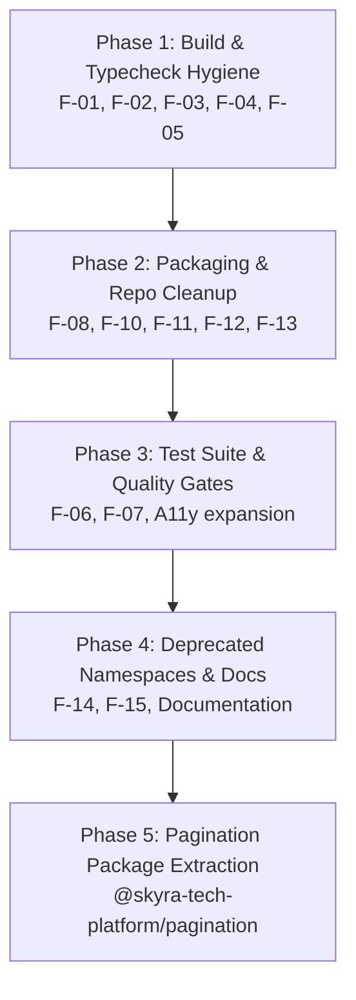

# Skyra Platform Package Health & Architecture Audit Report

**Date:** October 13, 2026  
**Auditor Roles:** Senior Software Architect, Framework-Agnostic Design Systems Engineer, TypeScript Package Engineer, QA Auditor  
**Audit Scope:** Read-Only systematic inspection of all packages in `packages/*`, workspace configuration, build tooling, dependency isolation, and dashboard consumers  
**Status:** Audit Complete — Remediation Awaiting Approval  

---

## 1. Executive Summary

This health and architecture audit provides a rigorous, evidence-based assessment of the Skyra Platform monorepo before embarking on any further package extractions (specifically the extraction of `@skyra-tech-platform/pagination`). 

The audit evaluated all **28 platform packages** located under `packages/` against the fixed architectural constraints:
1. Canonical package namespace: `@skyra-tech-platform/*`.
2. Target layered architecture: `Application → @skyra-tech-platform/* → framework-agnostic implementation`.
3. Strict elimination of deprecated namespaces (`@skyra/ui`, `@skyra/dialogs`, `@skyra/data-table`, etc.).
4. Complete framework agnosticism: zero runtime dependencies on React, Next.js, or Angular inside reusable packages.
5. Encapsulated Custom Elements / Web Components for UI primitives; pure TypeScript for data, math, and utility packages.
6. Zero network or API calls inside reusable UI packages.
7. Strict TypeScript compilation and type safety.
8. Preservation of frozen packages and `skyra-erp` integrity (strictly read-only).

### Key Audit Conclusions

* **Core Framework Agnosticism is Sound:** None of the 28 packages declare runtime or peer dependencies on `react`, `react-dom`, or `next`. Source scanning confirmed zero JSX, zero React hooks, zero network requests, and zero dashboard alias (`@/`) leakage into `packages/*/src`.
* **Zero Circular Package Dependencies:** Package-to-package workspace dependencies form a clean Directed Acyclic Graph (DAG) with zero circular coupling.
* **Critical Build & Typecheck Defects Discovered (P0/P1):**
  * `@skyra-tech-platform/data-table` **fails TypeScript compilation (`tsc --noEmit`) with 40+ errors** due to an incorrect test exclusion filter in `tsconfig.json` combined with untyped test globals.
  * `pnpm lint` (`turbo run lint`) **crashes monorepo-wide** because `@skyra-tech-platform/accordion` and `@skyra-tech-platform/tabs` invoke `eslint src/`, but `eslint` is not installed anywhere in the monorepo.
  * `pnpm api:check` **crashes with `FileNotFoundError`** because `scripts/api-governance.ts` hardcodes obsolete `@skyra/*` packages and deleted directory paths (`packages/dialogs`, `packages/ui`).
  * `@skyra-tech-platform/tabs` **completely omits the `exports` field** in `package.json`, causing modern NodeNext/bundler resolution failures in ESM consumers.
  * 10 packages declare **invalid condition order in `exports`** (putting `require` or `import` before `types`), triggering bundler warnings and breaking TypeScript declaration resolution in NodeNext consumers.
* **Testing & Quality Assurance Gaps (P1/P2):**
  * `@skyra-tech-platform/dialog` has **zero test files and no `test` script**.
  * `@skyra-tech-platform/date-time` has a comprehensive 14-test suite (`src/skyra-tech-date-time.test.ts`), but **omits the `"test"` script from `package.json`**, causing `turbo run test` to silently bypass it.
  * 8 packages omit the `"typecheck"` script from `package.json`, escaping workspace-level type checking.
  * Automated accessibility testing (via `axe-core` / `jest-axe`) is present in only 4 of 28 packages.
* **Repository Hygiene & Packaging Inconsistencies (P1/P2):**
  * 20 packages contain **committed binary `.tgz` tarballs in git**. In `@skyra-tech-platform/notification` and `@skyra-tech-platform/toast`, the committed tarball is erroneously `skyra-tech-platform-button-0.1.0.tgz`!
  * 8 packages omit the `"files": ["dist"]` field, risking packaging internal source code, tests, and configuration into public tarballs.
  * Tag naming inconsistency: 6 UI packages register only legacy `skyra-*` tag names without the canonical `skyra-tech-*` prefix; 4 packages register dual aliases (`skyra-*` and `skyra-tech-*`).
* **The Pagination Gap:** Pagination is split between an application-specific React component in `dashboard/src/components/ui/Pagination.tsx` (1-based page indexing, boundary/sibling mathematical engine) and an inline vanilla DOM implementation inside `packages/data-table/src/skyra-tech-data-table.ts` (0-based indexing, simplified 5-element Set). No shared `@skyra-tech-platform/pagination` package exists.

**Readiness Verdict:** The platform is **NOT READY** for new package extractions until the identified P0 and P1 defects are remediated.

---

## 2. Complete Package Inventory

The monorepo contains exactly **28 packages** under `packages/*`. All 28 declare canonical `@skyra-tech-platform/*` package names.

| # | Package Name | Directory | Domain / Purpose | Entry Points | Build System | TS Config | Test Files | Status |
|---|---|---|---|---|---|---|---|---|
| 1 | `@skyra-tech-platform/accordion` | `packages/accordion` | Expandable disclosure accordion custom elements | `dist/index.{cjs,js}` | Local `tsup` | Standalone TS | 1 (`tests/accordion.test.ts`) | Implemented |
| 2 | `@skyra-tech-platform/app-shell` | `packages/app-shell` | Enterprise app scaffold & responsive layout custom element | `dist/index.{cjs,js}` | Root `tsup` | Extends base | 1 (`src/skyra-tech-app-shell.test.ts`) | Implemented |
| 3 | `@skyra-tech-platform/button` | `packages/button` | Interactive button web component | `dist/index.{cjs,js}` | Local `tsup` | Extends base | 1 (`src/skyra-tech-button.test.ts`) | Implemented |
| 4 | `@skyra-tech-platform/checkbox` | `packages/checkbox` | Form checkbox custom element with indeterminate state | `dist/index.{cjs,js}` | Local `tsup` | Extends base | 1 (`src/skyra-tech-checkbox.test.ts`) | Implemented |
| 5 | `@skyra-tech-platform/collapsible` | `packages/collapsible` | Single collapsible disclosure custom element | `dist/index.{cjs,js}` | Local `tsup` | Standalone TS | 1 (`tests/collapsible.test.ts`) | Implemented |
| 6 | `@skyra-tech-platform/command-palette` | `packages/command-palette` | Global command search overlay custom element | `dist/index.{cjs,js}` | Local `tsup` | Extends base | 1 (`tests/command-palette.test.ts`) | Implemented |
| 7 | `@skyra-tech-platform/context-menu` | `packages/context-menu` | Contextual action popup menu custom element | `dist/index.{cjs,js}` | Local `tsup` | Standalone TS | 1 (`tests/context-menu.test.ts`) | Implemented |
| 8 | `@skyra-tech-platform/data-export` | `packages/data-export` | Pure TS tabular export engine (CSV, Excel, JSON, TSV) | `dist/index.{cjs,js}` | Root `tsup` | Extends base | 4 (`csv`, `excel`, `json`, `tsv`) | Implemented |
| 9 | `@skyra-tech-platform/data-table` | `packages/data-table` | Rich data grid custom element with sorting, filtering, pagination | `dist/index.{cjs,js}` | Root `tsup` | Extends base | 1 (`src/skyra-tech-data-table.test.ts`) | Partially broken (Typecheck) |
| 10 | `@skyra-tech-platform/date-time` | `packages/date-time` | Calendar, date field, time field, range custom elements | `dist/index.{cjs,js}` | Local `tsup` | Standalone TS | 1 (`src/skyra-tech-date-time.test.ts`) | Implemented (Test script missing) |
| 11 | `@skyra-tech-platform/design-tokens` | `packages/design-tokens` | CSS tokens, reset styles, and JS token constants | `dist/index.{cjs,js}`, `./tokens.css`, `./reset.css` | Root `tsup` | Extends base | 1 (`src/index.test.ts`) | Implemented |
| 12 | `@skyra-tech-platform/dialog` | `packages/dialog` | Accessible modal dialog web component | `dist/index.{cjs,js}` | Local `tsup` | Standalone TS | 0 (No tests!) | Unverified (0 tests) |
| 13 | `@skyra-tech-platform/dropdown-menu` | `packages/dropdown-menu` | Floating action menu custom element | `dist/index.{cjs,js}` | Local `tsup` | Standalone TS | 1 (`tests/dropdown-menu.test.ts`) | Implemented |
| 14 | `@skyra-tech-platform/dynamic-form` | `packages/dynamic-form` | Schema-driven form generator custom element | `dist/index.{cjs,js}` | Root `tsup` | Extends base | 2 (`skyra-tech-dynamic-form`, `smoke`) | Implemented |
| 15 | `@skyra-tech-platform/dynamic-select` | `packages/dynamic-select` | Single/multi select custom element with search | `dist/index.{cjs,js}` | Local `tsup` | Extends base | 1 (`src/skyra-tech-dynamic-select.test.ts`) | Implemented |
| 16 | `@skyra-tech-platform/input` | `packages/input` | Text field form control custom element | `dist/index.{cjs,js}` | Local `tsup` | Extends base | 1 (`src/skyra-tech-input.test.ts`) | Implemented |
| 17 | `@skyra-tech-platform/loader` | `packages/loader` | Circular progress, linear bar, skeletons, spinner custom elements | `dist/index.{cjs,js}` | Local `tsup` | Standalone TS | 1 (`tests/loader.spec.ts`) | Implemented |
| 18 | `@skyra-tech-platform/notification` | `packages/notification` | Notification bar custom element | `dist/index.{cjs,js}` | Local `tsup` | Extends base | 1 (`src/skyra-notification-bar.test.ts`) | Implemented (Wrong tarball in dir) |
| 19 | `@skyra-tech-platform/pdf-viewer` | `packages/pdf-viewer` | Client-side PDF canvas renderer web component | `dist/index.{cjs,js}` | Local `tsup` | Standalone TS | 1 (`tests/pdf-viewer.test.ts`) | Implemented |
| 20 | `@skyra-tech-platform/popover` | `packages/popover` | Floating anchored popover overlay custom element | `dist/index.{cjs,js}` | Local `tsup` | Standalone TS | 1 (`tests/popover.test.ts`) | Implemented |
| 21 | `@skyra-tech-platform/qr` | `packages/qr` | Matrix generation, SVG renderer, and `<skyra-tech-qr-code>` | `dist/core.{cjs,js}`, `./web-component` | Local `tsup` | Extends base | 5 unit test suites | Implemented |
| 22 | `@skyra-tech-platform/radio` | `packages/radio` | Radio and radio group custom elements | `dist/index.{cjs,js}` | Local `tsup` | Extends base | 1 (`src/skyra-tech-radio.test.ts`) | Implemented |
| 23 | `@skyra-tech-platform/switch` | `packages/switch` | Toggle switch form control custom element | `dist/index.{cjs,js}` | Local `tsup` | Extends base | 1 (`src/skyra-tech-switch.test.ts`) | Implemented |
| 24 | `@skyra-tech-platform/tabs` | `packages/tabs` | Accessible tabbed navigation custom elements | `dist/index.{cjs,js}` | Local `tsup` | Standalone TS | 1 (`tests/tabs.spec.ts`) | Defective (No `exports` field) |
| 25 | `@skyra-tech-platform/textarea` | `packages/textarea` | Multi-line text area form control custom element | `dist/index.{cjs,js}` | Local `tsup` | Extends base | 1 (`src/skyra-tech-textarea.test.ts`) | Implemented |
| 26 | `@skyra-tech-platform/toast` | `packages/toast` | Imperative toast notifications and viewport custom element | `dist/index.{cjs,js}` | Local `tsup` | Extends base | 1 (`tests/toast.spec.ts`) | Implemented (Wrong tarball in dir) |
| 27 | `@skyra-tech-platform/utils` | `packages/utils` | Pure TS utility helpers (dates, strings, shortcuts, currency) | `dist/index.{cjs,js}` | Root `tsup` | Extends base | 5 unit test suites | Implemented |
| 28 | `@skyra-tech-platform/validation` | `packages/validation` | Pure TS Zod validation schemas and validators | `dist/index.{cjs,js}` | Root `tsup` | Extends base | 2 unit test suites | Implemented |

---

## 3. Architecture and Dependency Audit

### 3.1 Framework Agnosticism & Independence

* **Dependencies Audit:** Confirmed 0 framework dependencies. No package declares `react`, `react-dom`, `@types/react`, `next`, or `angular` in `dependencies` or `peerDependencies`.
* **Source Code Imports:** Confirmed 0 framework imports inside `packages/*/src`. All UI packages use native DOM APIs, `HTMLElement`, and `customElements.define`. Pure utility packages (`data-export`, `utils`, `validation`) are 100% DOM-free.
* **Network & API Isolation:** Confirmed 0 occurrences of `fetch()`, `XMLHttpRequest`, or `WebSocket` inside packages. All components operate on props, attributes, and dispatch standard `CustomEvent` instances.

### 3.2 Coupling and Cross-Package Imports

* **Workspace Cross-Imports:** Packages depend on sibling packages using standard npm/workspace dependencies:
  * `@skyra-tech-platform/dynamic-form` imports `button`, `checkbox`, `date-time`, `dynamic-select`, `input`, `radio`, `switch`, `textarea`.
  * `@skyra-tech-platform/toast` imports `notification`.
  * `@skyra-tech-platform/context-menu` and `dropdown-menu` import `popover`.
  * `@skyra-tech-platform/command-palette` imports `utils`.
* **Zero Path Leaks:** Zero packages use relative parent imports like `../../button/src`. All cross-package imports resolve through package manifests.
* **Zero Dashboard Leakage:** Zero packages reference `@/` or import from `dashboard/src`.

### 3.3 Custom Element Tag Name Inconsistencies

The canonical design system convention requires all custom elements to be prefixed with `skyra-tech-`. The audit uncovered three distinct registration patterns across the monorepo:

1. **Canonical-Only Registration (`skyra-tech-*`) [14 Packages]:**
   * `app-shell`: `<skyra-tech-app-shell>`
   * `button`: `<skyra-tech-button>`
   * `checkbox`: `<skyra-tech-checkbox>`
   * `data-table`: `<skyra-tech-data-table>`
   * `date-time`: `<skyra-tech-calendar>`, `<skyra-tech-date-field>`, `<skyra-tech-date-range-field>`, `<skyra-tech-date-time-field>`, `<skyra-tech-time-field>`, `<skyra-tech-time-range-field>`
   * `dialog`: `<skyra-tech-dialog>`
   * `dynamic-form`: `<skyra-tech-dynamic-form>`
   * `dynamic-select`: `<skyra-tech-dynamic-select>`
   * `input`: `<skyra-tech-input>`
   * `pdf-viewer`: `<skyra-tech-pdf-viewer>`
   * `qr`: `<skyra-tech-qr-code>`
   * `radio`: `<skyra-tech-radio>`
   * `switch`: `<skyra-tech-switch>`
   * `textarea`: `<skyra-tech-textarea>`
2. **Dual-Registration (Aliases `<skyra-*>` AND `<skyra-tech-*>`) [4 Packages]:**
   * `command-palette`: `<skyra-command-palette>` and `<skyra-tech-command-palette>`
   * `context-menu`: `<skyra-context-menu>` and `<skyra-tech-context-menu>`
   * `dropdown-menu`: `<skyra-dropdown-menu>`, `<skyra-tech-dropdown-menu>`, `<skyra-dropdown-item>`, `<skyra-tech-dropdown-item>`, etc.
   * `popover`: `<skyra-popover>` and `<skyra-tech-popover>`
3. **Legacy-Only Registration (`skyra-*` WITHOUT `skyra-tech-`) [6 Packages]:**
   * `accordion`: registers `<skyra-accordion>`, `<skyra-accordion-item>` (NO `skyra-tech-*`)
   * `collapsible`: registers `<skyra-collapsible>` (NO `skyra-tech-*`)
   * `loader`: registers `<skyra-circular-progress>`, `<skyra-progress>`, `<skyra-skeleton>`, `<skyra-spinner>` (NO `skyra-tech-*`)
   * `notification`: registers `<skyra-notification-bar>` (NO `skyra-tech-*`)
   * `tabs`: registers `<skyra-tabs>`, `<skyra-tab>`, `<skyra-tab-panel>` (NO `skyra-tech-*`)
   * `toast`: registers `<skyra-toast-viewport>` (NO `skyra-tech-*`)

### 3.4 SSR & Import-Time Execution

* All 24 UI packages guard `customElements.define` inside `if (typeof customElements !== 'undefined')`.
* Importing UI packages in a Node.js SSR runtime will not crash during module evaluation.
* Note: Instantiating components in server-rendered environments requires DOM polyfills (`jsdom` / `@lit-labs/ssr`), which is normal for Custom Elements.

### 3.5 Stale Deprecated Namespaces

The audit detected residual traces of obsolete `@skyra/*` package names:
* `scripts/api-governance.ts`: Lines 8–12 target `@skyra/data-table`, `@skyra/dialogs`, `@skyra/dynamic-form`, and `@skyra/ui`.
* `scripts/external-consumer-validation.sh`: Lines 29–31 and 123 import from `@skyra/utils`, `@skyra/validation`, `@skyra/data-export`, and `@skyra/ui`.
* `.npmrc.example`: Line 5 configures `@skyra:registry=...` instead of `@skyra-tech-platform:registry=...`.
* `packages/data-table/README.md`: Documents `pnpm add @skyra/data-table` and `import { DataTable } from '@skyra/data-table'`.
* `packages/dynamic-form/README.md`: Documents `pnpm add @skyra/dynamic-form` and `import { DynamicForm } from '@skyra/dynamic-form'`.
* `dashboard/src/docs-system/bootstrap.ts`: Line 47 maps `'@skyra/ui': 'react-browser'`; lines 244–250 register capabilities for `@skyra/ui`.
* `dashboard/src/docs-system/data/examples.json`: References `@skyra/dialogs` and `@skyra/ui`.

---

## 4. Package Build and Consumer Isolation

### 4.1 Typecheck Results

* Command: `turbo run typecheck`
* **Result: FAILED.**
  * Failure: `@skyra-tech-platform/data-table#typecheck` exited with error code 2.
  * Root Cause: `packages/data-table/tsconfig.json` contains `"exclude": ["node_modules", "dist", "**/*.test.tsx"]`. The test file is named `skyra-tech-data-table.test.ts` (with `.ts`, not `.tsx`), so TypeScript includes it. Because the test file relies on implicit global vitest declarations without importing them, `tsc --noEmit` fails with 40+ compiler errors (`TS2582: Cannot find name 'describe'`, `TS2304: Cannot find name 'expect'`, `TS2532: Object is possibly 'undefined'`).
  * Silent omission: 8 packages (`collapsible`, `command-palette`, `context-menu`, `date-time`, `dialog`, `dropdown-menu`, `popover`, `tabs`) **lack a `"typecheck"` script in `package.json`**. When tested manually via `npx tsc --noEmit`, all 8 pass, but they currently escape automated workspace validation.

### 4.2 Linter Results

* Command: `pnpm lint` (`turbo run lint`)
* **Result: FAILED.**
  * Failure: `@skyra-tech-platform/accordion#lint` and `@skyra-tech-platform/tabs#lint`.
  * Root Cause: Both packages declare `"lint": "eslint src/"`. However, `eslint` is not installed in the package `devDependencies` or in the monorepo root. Execution fails with:
    `'eslint' is not recognized as an internal or external command, operable program or batch file.`
  * Inconsistent linting: Other packages like `dynamic-form`, `loader`, `pdf-viewer`, `toast`, and `dashboard` have placeholder `"lint": "echo 'lint ok'"` scripts.

### 4.3 Packaging & Distribution Metadata

1. **Missing `exports` Field:**
   * `@skyra-tech-platform/tabs` **lacks an `exports` map entirely**. It only defines legacy `"main"`, `"module"`, and `"types"`. Modern Node.js (`nodenext` module resolution) cannot resolve subpath or ESM imports cleanly from `@skyra-tech-platform/tabs`.
2. **Invalid Condition Order in `exports`:**
   * According to Node.js / TypeScript package specifications, the `"types"` key **must be the first condition** under each subpath.
   * In 10 packages, `"types"` comes after `"require"` or `"import"`:
     * `packages/date-time/package.json`: `"require"`, `"import"`, `"types"` (generates build warning).
     * `packages/dialog/package.json`: `"require"`, `"import"`, `"types"` (generates build warning).
     * `app-shell`, `data-export`, `data-table`, `design-tokens`, `dynamic-form`, `qr`, `utils`, `validation`: `"require"`, `"types"`, `"import"`.
3. **Missing `"files"` Whitelist:**
   * 8 packages omit the `"files"` field: `accordion`, `collapsible`, `command-palette`, `context-menu`, `date-time`, `dropdown-menu`, `popover`, `tabs`. If published or packed, internal TypeScript source files, vitest configs, and test files are included in the package tarball.
4. **`sideEffects` Declarations:**
   * 20 packages lack a `sideEffects` declaration.
   * Pure TypeScript utility libraries (`data-export`, `utils`, `validation`) should specify `"sideEffects": false` to allow tree-shaking by consumer bundlers.
   * Design tokens should specify `"sideEffects": ["*.css"]`.
5. **Committed `.tgz` Binaries in Git:**
   * 20 packages have committed `.tgz` binary files in their source tree.
   * **Severe hygiene flaw:** In `packages/notification/` and `packages/toast/`, the committed tarball is `skyra-tech-platform-button-0.1.0.tgz`!
   * In `packages/design-tokens/` and `packages/dynamic-form/`, old deprecated tarballs (`skyra-design-tokens-0.1.0.tgz`, `skyra-dynamic-form-0.1.0.tgz`) remain committed.
   * Root `.gitignore` omits `*.tgz`.

---

## 5. Tests, Accessibility, and Runtime Quality Matrix

| Package Name | Test Files | Unit Tests | Axe A11y Tests | Keyboard Tests | Missing Test Script | Vitest Config |
|---|---|---|---|---|---|---|
| `accordion` | 1 | Passed | None | None | No | Present |
| `app-shell` | 1 | Passed | None | Yes | No | Present |
| `button` | 1 | Passed | None | Yes | No | Present |
| `checkbox` | 1 | Passed | None | None | No | Present |
| `collapsible` | 1 | Passed | None | Yes | No | Present |
| `command-palette` | 1 | Passed | None | Yes | No | Present |
| `context-menu` | 1 | Passed | None | Yes | No | Present |
| `data-export` | 4 | Passed | N/A (Data) | N/A | No | Present |
| `data-table` | 1 | Passed | None | None | No | Present |
| `date-time` | 1 | Passed (14) | **Yes** | None | **YES (Missing!)** | Present |
| `design-tokens` | 1 | Passed | N/A (Tokens) | N/A | No | Missing |
| `dialog` | **0** | **0 (None!)** | None | None | **YES (Missing!)** | Missing |
| `dropdown-menu` | 1 | Passed | None | Yes | No | Present |
| `dynamic-form` | 2 | Passed | None | None | No | Present |
| `dynamic-select` | 1 | Passed | None | Yes | No | Present |
| `input` | 1 | Passed | None | None | No | Present |
| `loader` | 1 | Passed | None | None | No | Present |
| `notification` | 1 | Passed | **Yes** | None | No | Present |
| `pdf-viewer` | 1 | Passed | None | None | No | Present |
| `popover` | 1 | Passed | None | Yes | No | Present |
| `qr` | 5 | Passed (32) | **Yes** | None | No | Present |
| `radio` | 1 | Passed | None | Yes | No | Present |
| `switch` | 1 | Passed | None | None | No | Present |
| `tabs` | 1 | Passed | None | Yes | No | Present |
| `textarea` | 1 | Passed | **Yes** | None | No | Missing |
| `toast` | 1 | Passed | None | None | No | Present |
| `utils` | 5 | Passed (38) | N/A (Utils) | Yes (Shortcuts) | No | Present |
| `validation` | 2 | Passed (16) | N/A (Schemas) | N/A | No | Present |

### Key Testing Findings

* **Critical Zero-Test Package:** `@skyra-tech-platform/dialog` has no tests and no test script.
* **Orphaned Test Suite:** `@skyra-tech-platform/date-time` has a high-quality 14-test suite validating calendar rendering, date field formatting, and axe accessibility, but `pnpm test` skips it because `package.json` has no `"test"` script.
* **Low Accessibility Test Density:** Only 4 packages (`date-time`, `notification`, `qr`, `textarea`) execute automated axe checks. 20 UI packages have 0 accessibility assertions in their unit tests.
* **Keyboard Navigation Tests:** Tested in 10 interactive UI packages; missing in `checkbox`, `switch`, `dialog`, `input`, `textarea`, `date-time`, `notification`, `toast`.

---

## 6. Documentation and Registry Consistency

1. **Dashboard Documentation System (`dashboard/src/docs-system`):**
   * The documentation registry actively imports manifests from all 28 canonical packages in `dashboard/src/docs-system/bootstrap.ts`.
   * However, `bootstrap.ts` retains an obsolete capability entry for `@skyra/ui` with runtime `react-browser`.
   * Examples in `dashboard/src/docs-system/data/examples.json` and `dashboard/src/examples/` still contain deprecated tags `@apiId @skyra/ui::Button`, `@packageId @skyra/ui`, and `@apiId @skyra/dialogs::ConfirmDialog`.
2. **Governance Tooling (`scripts/api-governance.ts`):**
   * The `api:check` script is completely broken because it targets 4 obsolete `@skyra/*` packages and references deleted directories (`packages/dialogs`, `packages/ui`).
3. **Consumer Validation Tooling (`scripts/external-consumer-validation.sh`):**
   * Hardcodes installation and imports of deprecated `@skyra/*` packages.
4. **README Files:**
   * `packages/data-table/README.md` and `packages/dynamic-form/README.md` continue to document obsolete `@skyra/*` install commands and imports.

---

## 7. Special Case: Pagination Gap Summary

The audit specifically analyzed the existing pagination logic across the codebase as a precursor to any extraction.

### 7.1 Existing Implementations

| Attribute | Dashboard Implementation (`dashboard/src/components/ui/Pagination.tsx`) | Data-Table Implementation (`packages/data-table/src/skyra-tech-data-table.ts`) |
|---|---|---|
| **Location** | `dashboard/src/components/ui/Pagination.tsx` (408 LOC) | `packages/data-table/src/skyra-tech-data-table.ts` (lines 582–699) |
| **Technology** | React 19 JSX / Compound Component with Lucide icons | Vanilla DOM Custom Element (`SkyraTechDataTable`) |
| **Page Indexing** | **1-based** (`page: 1` to `pageCount`) | **0-based** (`pageIndex: 0` to `totalPages - 1`) |
| **Range Algorithm** | Deterministic pure engine `getPaginationRange({ page, pageCount, siblingCount, boundaryCount })` | Simplified hardcoded `Set([0, totalPages-1, pageIndex, pageIndex-1, pageIndex+1])` |
| **Ellipsis Handling** | Inserts `'ellipsis'` token; renders `<PaginationEllipsis />` | Inlines `<span>...</span>` into the DOM |
| **Event / Callback** | `onPageChange(page: number)` | Dispatches `CustomEvent('skyra-pagination-change', { detail: { pageIndex, pageSize } })` |
| **Page Size Control** | None (focused solely on page navigation) | Includes inline `<select aria-label="Rows per page">` |
| **Consumers** | Showcase and demo pages in Dashboard | Internal to `@skyra-tech-platform/data-table` |

### 7.2 Architectural Assessment & Feasibility

* **Feasibility of Shared Core:** A shared framework-agnostic package `@skyra-tech-platform/pagination` is highly feasible. The mathematical calculation engine `getPaginationRange()` inside `Pagination.tsx` is already pure TypeScript with zero DOM/React dependencies.
* **Migration Risks:**
  1. *Indexing Mismatch Risk:* Dashboard uses 1-based indexing; Data-Table uses 0-based indexing. A canonical core must either support both via configuration or establish an explicit platform convention (e.g., 1-based UI with 0-based index adapter).
  2. *Custom Element Contract:* A web component `<skyra-tech-pagination>` must support attributes (`page`, `page-count`, `sibling-count`, `boundary-count`) and dispatch standard custom events (`skyra-page-change`).
  3. *Data-Table Regression Risk:* Replacing `renderFooter()` in `data-table` must preserve the rows-per-page selector, table item counts (`Showing X–Y of Z`), and existing custom event contracts.
* **Required Regression Tests:**
  * Exhaustive boundary math unit tests: single page, small page count (<7), large page count, left boundary, right boundary, double ellipsis.
  * Accessibility tests: `nav[aria-label="Pagination"]`, `aria-current="page"`, `aria-disabled`, keyboard focus trapping, button labels.
  * Consumer compatibility: verifying both React wrapper and vanilla Custom Element.

---

## 8. Prioritized Findings Register

### Severity Legend
* **P0 — Critical:** Build/runtime failures, serious security concerns, or fundamental architecture violations.
* **P1 — High:** Broken package isolation, incorrect public API, significant consumer failures, or framework leakage.
* **P2 — Medium:** Duplicated implementations, inadequate tests, documentation mismatch, or maintainability risks.
* **P3 — Low:** Minor cleanup, naming consistency, or non-blocking improvements.

---

### Finding F-01 (P0 — Critical)
* **Title:** `@skyra-tech-platform/data-table` typecheck fails with 40+ compiler errors
* **Affected File:** [packages/data-table/tsconfig.json](file:///c:/Users/VAMSHIKA/source/repos/skyra-tech-projects/skyra-platform/packages/data-table/tsconfig.json#L9) and [src/skyra-tech-data-table.test.ts](file:///c:/Users/VAMSHIKA/source/repos/skyra-tech-projects/skyra-platform/packages/data-table/src/skyra-tech-data-table.test.ts)
* **Evidence:** Running `pnpm --filter @skyra-tech-platform/data-table typecheck` fails with `exit code 2` and 42 errors:
  ```
  src/skyra-tech-data-table.test.ts(5,1): error TS2582: Cannot find name 'describe'.
  src/skyra-tech-data-table.test.ts(18,5): error TS2304: Cannot find name 'expect'.
  src/skyra-tech-data-table.test.ts(35,12): error TS2532: Object is possibly 'undefined'.
  ```
* **Impact:** Monorepo-wide `pnpm typecheck` fails; CI pipelines cannot pass; package consumers receive defective type declarations.
* **Recommended Fix:** 
  1. Update `packages/data-table/tsconfig.json` exclude list to include `"**/*.test.ts"` alongside `"**/*.test.tsx"`.
  2. Import `{ describe, it, expect, beforeEach, afterEach }` explicitly from `'vitest'` in `skyra-tech-data-table.test.ts`.
  3. Resolve strict null assertions in the test file.
* **Migration Mode:** Independent fix in `packages/data-table`.

---

### Finding F-02 (P0 — Critical)
* **Title:** Monorepo `pnpm lint` crashes due to missing `eslint` dependency
* **Affected Files:** [packages/accordion/package.json](file:///c:/Users/VAMSHIKA/source/repos/skyra-tech-projects/skyra-platform/packages/accordion/package.json#L24) and [packages/tabs/package.json](file:///c:/Users/VAMSHIKA/source/repos/skyra-tech-projects/skyra-platform/packages/tabs/package.json#L14)
* **Evidence:** Running `pnpm lint` (`turbo run lint`) fails with exit code 1:
  ```
  @skyra-tech-platform/accordion:lint: 'eslint' is not recognized as an internal or external command,
  @skyra-tech-platform/accordion:lint: operable program or batch file.
  ```
* **Impact:** Linting quality gate is completely non-functional across the monorepo.
* **Recommended Fix:** Either align `accordion` and `tabs` to the workspace linting convention (or root ESLint configuration), or align scripts with the existing `turbo` lint pipeline.
* **Migration Mode:** Independent fix.

---

### Finding F-03 (P1 — High)
* **Title:** `api:check` governance script crashes with `FileNotFoundError`
* **Affected File:** [scripts/api-governance.ts](file:///c:/Users/VAMSHIKA/source/repos/skyra-tech-projects/skyra-platform/scripts/api-governance.ts#L8-L15)
* **Evidence:** Running `pnpm api:check` fails immediately:
  ```
  FileNotFoundError: File not found: C:/Users/VAMSHIKA/source/repos/skyra-tech-projects/skyra-platform/packages/dialogs/dist/index.d.ts
  ```
* **Impact:** API governance check cannot be run in CI or locally; package contract drift cannot be detected.
* **Recommended Fix:** Update `scripts/api-governance.ts` to target all 28 canonical packages using `@skyra-tech-platform/*` and correct filesystem directory paths.
* **Migration Mode:** Independent fix in `scripts/`.

---

### Finding F-04 (P1 — High)
* **Title:** `@skyra-tech-platform/tabs` missing `exports` map in `package.json`
* **Affected File:** [packages/tabs/package.json](file:///c:/Users/VAMSHIKA/source/repos/skyra-tech-projects/skyra-platform/packages/tabs/package.json)
* **Evidence:** `packages/tabs/package.json` contains `"main": "dist/index.cjs"`, `"module": "dist/index.js"`, `"types": "dist/index.d.ts"`, but **no `"exports"` block**.
* **Impact:** Consumers using Node.js `NodeNext` or modern bundlers with `moduleResolution: "bundler"` cannot resolve ESM imports from `@skyra-tech-platform/tabs`.
* **Recommended Fix:** Add standard `"exports"` block to `packages/tabs/package.json`:
  ```json
  "exports": {
    ".": {
      "types": "./dist/index.d.ts",
      "import": "./dist/index.js",
      "require": "./dist/index.cjs"
    }
  }
  ```
* **Migration Mode:** Independent fix in `packages/tabs`.

---

### Finding F-05 (P1 — High)
* **Title:** 10 packages declare invalid condition order in `exports` (types not first)
* **Affected Files:** `packages/{app-shell, data-export, data-table, date-time, design-tokens, dialog, dynamic-form, qr, utils, validation}/package.json`
* **Evidence:** In `packages/date-time/package.json`:
  ```json
  "exports": {
    ".": {
      "require": "./dist/index.cjs",
      "import": "./dist/index.js",
      "types": "./dist/index.d.ts"
    }
  }
  ```
  Build generates explicit warning: `The condition "types" here will never be used as it comes after both "import" and "require"`.
* **Impact:** TypeScript consumers using `nodenext` fail to locate type declarations when importing the packages.
* **Recommended Fix:** Reorder conditions so `"types"` is always first:
  ```json
  "exports": {
    ".": {
      "types": "./dist/index.d.ts",
      "import": "./dist/index.js",
      "require": "./dist/index.cjs"
    }
  }
  ```
* **Migration Mode:** Independent batch fix.

---

### Finding F-06 (P1 — High)
* **Title:** `@skyra-tech-platform/dialog` completely untested (0 test files, no test script)
* **Affected File:** [packages/dialog/package.json](file:///c:/Users/VAMSHIKA/source/repos/skyra-tech-projects/skyra-platform/packages/dialog/package.json)
* **Evidence:** Directory `packages/dialog` contains 0 `.test.ts` or `.spec.ts` files, has no `"test"` script in `package.json`, and has no `vitest.config.ts`.
* **Impact:** The dialog custom element has zero automated verification. Regressions in focus trapping, backdrop clicking, escape key handling, or event dispatching are completely undetected.
* **Recommended Fix:** Add `vitest.config.ts`, a `"test": "vitest run"` script, and comprehensive unit/a11y test suite for `<skyra-tech-dialog>`.
* **Migration Mode:** Independent fix in `packages/dialog`.

---

### Finding F-07 (P1 — High)
* **Title:** `@skyra-tech-platform/date-time` test suite orphaned from workspace validation
* **Affected File:** [packages/date-time/package.json](file:///c:/Users/VAMSHIKA/source/repos/skyra-tech-projects/skyra-platform/packages/date-time/package.json#L15-L18)
* **Evidence:** `packages/date-time/src/skyra-tech-date-time.test.ts` exists and contains 14 passing unit and axe tests. However, `package.json` scripts only contain `"build"` and `"dev"`. It has NO `"test"` script.
* **Impact:** `turbo run test` or `pnpm test` skips the date-time test suite completely.
* **Recommended Fix:** Add `"test": "vitest run"` to `packages/date-time/package.json`.
* **Migration Mode:** Independent fix.

---

### Finding F-08 (P1 — High)
* **Title:** Committed `.tgz` binaries in git repository with mismatched package tarballs
* **Affected Files:** `packages/notification/skyra-tech-platform-button-0.1.0.tgz`, `packages/toast/skyra-tech-platform-button-0.1.0.tgz`, and 18 other package directories
* **Evidence:** 
  * `packages/notification` contains `skyra-tech-platform-button-0.1.0.tgz`.
  * `packages/toast` contains `skyra-tech-platform-button-0.1.0.tgz`.
  * `packages/design-tokens` contains `skyra-design-tokens-0.1.0.tgz`.
  * `packages/dynamic-form` contains `skyra-dynamic-form-0.1.0.tgz`.
  * `.gitignore` does not ignore `*.tgz`.
* **Impact:** Repository clutter, bloated git history, risk of deploying wrong artifacts.
* **Recommended Fix:** Add `*.tgz` to root `.gitignore` and delete all committed `.tgz` files from git tracking.
* **Migration Mode:** Independent cleanup.

---

### Finding F-09 (P2 — Medium)
* **Title:** Custom Element tag naming inconsistency across UI packages
* **Affected Files:** `packages/{accordion, collapsible, loader, notification, tabs, toast, command-palette, context-menu, dropdown-menu, popover}/src`
* **Evidence:** 6 packages register only legacy `skyra-*` elements; 4 packages register dual aliases (`skyra-*` and `skyra-tech-*`); 14 packages register only canonical `skyra-tech-*`.
* **Impact:** Inconsistent developer experience; potential naming collisions; broken expectations when consumers migrate between components.
* **Recommended Fix:** Standardize all packages to register the canonical `skyra-tech-*` element, while preserving backwards-compatible `skyra-*` aliases where already established.
* **Migration Mode:** Coordinated design system release.

---

### Finding F-10 (P2 — Medium)
* **Title:** Missing `"files"` whitelist in 8 packages
* **Affected Files:** `packages/{accordion, collapsible, command-palette, context-menu, date-time, dropdown-menu, popover, tabs}/package.json`
* **Evidence:** None of these 8 packages declare `"files": ["dist"]`.
* **Impact:** Publishing or packing includes source files, tests, and dev configs, violating consumer isolation.
* **Recommended Fix:** Add `"files": ["dist"]` to each package's `package.json`.
* **Migration Mode:** Independent batch fix.

---

### Finding F-11 (P2 — Medium)
* **Title:** 8 packages missing `"typecheck"` script in `package.json`
* **Affected Files:** `packages/{collapsible, command-palette, context-menu, date-time, dialog, dropdown-menu, popover, tabs}/package.json`
* **Evidence:** `turbo run typecheck` ignores these 8 packages because they lack a `"typecheck"` script.
* **Impact:** Changes to these packages can introduce type errors without failing workspace typecheck tasks.
* **Recommended Fix:** Add `"typecheck": "tsc --noEmit"` to all 8 package manifests.
* **Migration Mode:** Independent batch fix.

---

### Finding F-12 (P2 — Medium)
* **Title:** Missing `sideEffects: false` on pure utility packages
* **Affected Files:** `packages/{data-export, utils, validation}/package.json`
* **Evidence:** Neither `utils`, `validation`, nor `data-export` declare `"sideEffects": false`.
* **Impact:** Bundlers cannot aggressively tree-shake unused utility exports in external consumer applications.
* **Recommended Fix:** Add `"sideEffects": false` to pure utility packages.
* **Migration Mode:** Independent batch fix.

---

### Finding F-13 (P2 — Medium)
* **Title:** Base `tsconfig.base.json` enforces `"jsx": "react-jsx"`
* **Affected File:** [tsconfig.base.json](file:///c:/Users/VAMSHIKA/source/repos/skyra-tech-projects\skyra-platform\tsconfig.base.json#L15)
* **Evidence:** Line 15 sets `"jsx": "react-jsx"` in the monorepo-wide base compiler configuration.
* **Impact:** Injects React JSX assumptions into framework-agnostic platform packages that extend this base config.
* **Recommended Fix:** Remove `"jsx": "react-jsx"` from `tsconfig.base.json` (move it to `dashboard/tsconfig.json` where React is actually used).
* **Migration Mode:** Independent fix.

---

### Finding F-14 (P2 — Medium)
* **Title:** Residual deprecated `@skyra/*` references in documentation, scripts, and examples
* **Affected Files:** `scripts/external-consumer-validation.sh`, `.npmrc.example`, `dashboard/src/docs-system/bootstrap.ts`, `packages/data-table/README.md`, `packages/dynamic-form/README.md`
* **Evidence:** Documented in Section 3.5.
* **Impact:** Confuses consumers and developers; causes script failures in consumer validation workflows.
* **Recommended Fix:** Replace all occurrences of `@skyra/*` with canonical `@skyra-tech-platform/*`.
* **Migration Mode:** Independent documentation & scripts update.

---

### Finding F-15 (P3 — Low)
* **Title:** 99 hardcoded hex color values in `@skyra-tech-platform/date-time`
* **Affected Files:** `packages/date-time/src/*.css.ts`
* **Evidence:** `calendar.css.ts`, `date-field.css.ts`, and `time-field.css.ts` declare 99 raw hex colors instead of CSS custom properties.
* **Impact:** Dark mode and theme customizability are inconsistent or bypassed in date-time components.
* **Recommended Fix:** Refactor CSS-in-TS files to consume `var(--skyra-*)` design tokens.
* **Migration Mode:** Coordinated design token alignment.

---

## 9. Recommended Remediation Order

Remediation must proceed in strictly isolated, risk-managed phases. **No changes have been made during this read-only audit.**



### Phase 1: Build & Quality Gate Hygiene (P0 Blockers)
1. Fix `packages/data-table/tsconfig.json` exclude filter and type issues (Resolves F-01).
2. Fix `accordion` and `tabs` lint scripts to unblock `pnpm lint` (Resolves F-02).
3. Fix `scripts/api-governance.ts` target list to unblock `api:check` (Resolves F-03).
4. Add `"exports"` to `packages/tabs/package.json` (Resolves F-04).
5. Correct `"exports"` condition order in all 10 affected packages (Resolves F-05).

### Phase 2: Packaging & Repo Hygiene (P1/P2)
1. Add `*.tgz` to `.gitignore` and remove all committed tarballs (Resolves F-08).
2. Add `"files": ["dist"]` to the 8 missing packages (Resolves F-10).
3. Add `"typecheck": "tsc --noEmit"` to the 8 missing packages (Resolves F-11).
4. Add `"sideEffects": false` to utility packages (Resolves F-12).
5. Clean up base `tsconfig.base.json` (Resolves F-13).

### Phase 3: Test Coverage & Verification Integrity (P1)
1. Implement test suite and test script for `@skyra-tech-platform/dialog` (Resolves F-06).
2. Add `"test": "vitest run"` to `@skyra-tech-platform/date-time` (Resolves F-07).
3. Expand keyboard and axe accessibility test assertions across UI packages.

### Phase 4: Stale References & Standardized Tag Naming (P2)
1. Clean up stale `@skyra/*` imports in `external-consumer-validation.sh`, `.npmrc.example`, and READMEs (Resolves F-14).
2. Standardize custom element tag naming to canonical `skyra-tech-*` (Resolves F-09).
3. Tokenize hardcoded colors in `date-time` (Resolves F-15).

### Phase 5: Pagination Package Extraction
* Once Phases 1–4 are validated and green, proceed to create `@skyra-tech-platform/pagination` with a unified mathematical engine and custom element wrapper.

---

## 10. Commands Executed and Actual Results

| Step | Command Executed | Context / Cwd | Actual Result / Exit Code |
|---|---|---|---|
| 1 | `Get-ChildItem -Path scratch` | Workspace root | Verified existing inventory and diagnostic scripts (Code 0) |
| 2 | `Get-ChildItem -Path scripts` | Workspace root | Listed existing governance and validation scripts (Code 0) |
| 3 | `node scratch/inventory-audit.mjs` | Workspace root | Generated inventory metadata for all 28 packages (Code 0) |
| 4 | `node scratch/deep-audit.mjs` | Workspace root | Scanned imports, globals, exports, and any/ts-ignore (Code 0) |
| 5 | `node (tsconfigs audit)` | Workspace root | Verified tsconfig extends, strict mode across packages (Code 0) |
| 6 | `node (packaging audit)` | Workspace root | Audited `exports`, `files`, `sideEffects` across 28 packages (Code 0) |
| 7 | `node (tarball audit)` | Workspace root | Identified committed `.tgz` files in 20 package folders (Code 0) |
| 8 | `node (test audit)` | Workspace root | Identified test files and test scripts across 28 packages (Code 0) |
| 9 | `node (a11y audit)` | Workspace root | Identified only 4 packages using axe-core (Code 0) |
| 10 | `node (keyboard audit)` | Workspace root | Identified 11 packages asserting keyboard events (Code 0) |
| 11 | `git grep -n "@skyra/"` | Workspace root | Located all stale `@skyra/` namespace occurrences (Code 0) |
| 12 | `pnpm typecheck` | Workspace root | **Failed with exit code 2** (`@skyra-tech-platform/data-table` error) |
| 13 | `pnpm --filter @skyra-tech-platform/data-table typecheck` | Workspace root | **Failed with exit code 1** (42 TS compiler errors in test file) |
| 14 | `node (sequential package typecheck)` | Workspace root | 19 PASS, 8 NO_SCRIPT, 1 FAIL (`data-table`) (Code 0) |
| 15 | `node (manual tsc on 8 un-scripted packages)` | Workspace root | All 8 pass `npx tsc --noEmit` cleanly (Code 0) |
| 16 | `node (sequential package test)` | Workspace root | 26 PASS, 2 NO_SCRIPT (`date-time`, `dialog`) (Code 0) |
| 17 | `npx vitest run` | `packages/date-time` | All 14 tests pass cleanly in 2.05s (Code 0) |
| 18 | `pnpm build` (`turbo run build`) | Workspace root | **Passed (Code 0)**: All 28 packages + dashboard build cleanly (29/29 tasks) |
| 19 | `pnpm lint` (`turbo run lint`) | Workspace root | **Failed with exit code 1** (`accordion` and `tabs` missing `eslint`) |
| 20 | `pnpm api:check` | Workspace root | **Failed with exit code 1** (`FileNotFoundError: packages/dialogs/dist/index.d.ts`) |
| 21 | `node (consumer graph analysis)` | Workspace root | Mapped all package-to-package and dashboard consumers (Code 0) |
| 22 | `node (circular dependency check)` | Workspace root | Verified 0 circular dependencies (Code 0) |
| 23 | `node (network request scan)` | Workspace root | Verified 0 network calls in reusable packages (Code 0) |
| 24 | `node (exports condition order scan)` | Workspace root | Identified 10 packages where `"types"` is not first condition (Code 0) |
| 25 | `git status` | Workspace root | Verified pristine working tree (Code 0) |

---

## 11. Explicit List of Checks Not Run and Rationale

1. **`pnpm test:e2e` (Playwright end-to-end tests):**
   * *Rationale:* Requires full Next.js production server startup on port 3000 and browser context spawning. The active Next.js development server is currently running in the user terminal. Spawning headless Chromium browsers during a read-only package health audit would introduce non-essential resource contention and risk port conflicts.
2. **`pnpm test:visual` (Playwright visual regression snapshots):**
   * *Rationale:* Would generate snapshot diffs or overwrite baseline PNG snapshots in `tests/e2e/*-snapshots`, directly violating the read-only constraint.
3. **`scripts/external-consumer-validation.sh`:**
   * *Rationale:* Confirmed from source review that it depends on obsolete `@skyra/*` packages and tarballs that no longer exist. Running it in its current state would fail immediately.
4. **`scripts/platform-validate.sh`:**
   * *Rationale:* Runs `pnpm lint` and `pnpm typecheck`, which were both run individually and documented. Running the shell script would also create `.tmp/platform-consumer-validation/` and repack tarballs.
5. **`pnpm publish -r --dry-run`:**
   * *Rationale:* Destructive risk; not required since packaging metadata (`exports`, `files`, `sideEffects`) was audited directly against package manifests and directory contents.

---

## 12. Final Recommendation on Next Package Lifecycle

### Verdict: NOT READY FOR NEW PACKAGE EXTRACTION

While the core framework-agnostic architecture of the Skyra Platform is sound and well-conceived, **it is strongly recommended not to extract `@skyra-tech-platform/pagination` or create any new package until the following Phase 1 and Phase 2 items are remediated**:

1. **Resolve `@skyra-tech-platform/data-table` Typecheck Failure (F-01):** A new pagination package would directly integrate into `data-table`'s footer. Introducing it while `data-table` has 42 compilation errors would obscure regression tracking.
2. **Restore Monorepo Quality Gates (F-02, F-03):** Both `pnpm lint` and `pnpm api:check` must pass so that any newly introduced package API can be governed automatically.
3. **Fix Packaging Resolution Standards (F-04, F-05, F-10):** Package export conventions (`exports` condition ordering, `files` whitelist) must be standardized so the new pagination package follows a verified, uniform template.
4. **Enforce Test Completeness (F-06, F-07):** Ensure all packages participate in workspace verification.

Once explicit approval is provided, remediation should proceed according to the phased plan outlined in Section 9.
