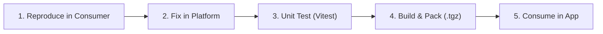

# Skyra Platform — Shared Component Contribution & Integration Guide

**Document Version:** 1.0.0  
**Target Audience:** Frontend Engineers, Design System Engineers, Component Library Authors  
**Classification:** Engineering Standard (Mandatory Architectural Governance)

---

## 1. Architectural Philosophy

The **Skyra Platform** component library provides the centralized, framework-agnostic UI foundation for all Skyra SaaS applications, including Skyra LogHub, Skyra Console, and administrative workstations.

### Core Non-Negotiables
1. **Framework Independence:** All shared visual primitives are built as standard **W3C Custom Elements (Web Components)** using Shadow DOM. They run natively across Angular, React, Vue, Svelte, or vanilla DOM environments without framework adapters.
2. **Authoritative Design Tokens:** No hardcoded colors, spacing units, font declarations, or border radii are permitted in component source code. All styling must bind to `--skyra-*` tokens provided by `@skyra-tech-platform/design-tokens`.
3. **WCAG 2.2 Level AA Compliance:** Every shared component must provide first-class accessibility: keyboard operability, ARIA attributes, semantic roles, high-contrast states, and focus ring indicators.
4. **Zero Upstream Duplication:** Product repositories (such as `skyra-log-hub`) must **never** clone, fork, or copy component source code into local application directories. If a component is missing, defective, or incomplete, the enhancement must occur directly within `skyra-platform`.

---

## 2. Package Structure Standard

Every component in `skyra-platform/packages/<component-name>` adheres to the canonical layout:

```text
packages/<component-name>/
├── package.json
├── tsconfig.json
├── src/
│   ├── index.ts                     # Public barrel export
│   ├── <component-name>.css.ts      # CSS template literal consuming --skyra-* tokens
│   ├── skyra-tech-<component>.ts     # Custom Element implementation class
│   └── skyra-tech-<component>.test.ts # Vitest unit test suite (jsdom)
└── dist/                             # tsup output (ESM, CJS, DTS)
```

### Essential `package.json` Configuration

```json
{
  "name": "@skyra-tech-platform/<component-name>",
  "version": "0.1.0",
  "sideEffects": true,
  "description": "Skyra Platform reusable <component-name> Web Component",
  "type": "module",
  "exports": {
    ".": {
      "require": "./dist/index.cjs",
      "types": "./dist/index.d.ts",
      "import": "./dist/index.js"
    }
  },
  "main": "./dist/index.cjs",
  "types": "./dist/index.d.ts",
  "module": "./dist/index.js",
  "files": [
    "dist"
  ],
  "scripts": {
    "build": "tsup --config ../../tsup.config.ts",
    "typecheck": "tsc --noEmit",
    "lint": "echo 'lint: ok'",
    "test": "vitest run",
    "clean": "rm -rf dist"
  },
  "dependencies": {
    "@skyra-tech-platform/design-tokens": "workspace:*",
    "@skyra-tech-platform/utils": "workspace:*"
  },
  "devDependencies": {
    "@vitest/coverage-v8": "^2.1.8",
    "jsdom": "^25.0.0",
    "typescript": "^5.7.0",
    "vitest": "^2.1.8"
  }
}
```

> [!IMPORTANT]
> Always set `"sideEffects": true` on custom element packages. When consumer bundlers (such as esbuild or Vite) encounter side-effect-free packages, bare registration imports like `import '@skyra-tech-platform/drawer'` will be tree-shaken and stripped out!

---

## 3. Authoritative Design Tokens Reference

When designing component styles in `<component-name>.css.ts`, map properties directly to official CSS custom properties:

| Category | Token | Light Theme Value | Dark Theme Value |
|---|---|---|---|
| Primary Brand | `--skyra-primary` | `#0A58CA` | `#0A58CA` |
| Primary Hover | `--skyra-primary-hover` | `#0847a8` | `#0d6efd` |
| Primary Light | `--skyra-primary-light` | `rgba(10, 88, 202, 0.1)` | `rgba(10, 88, 202, 0.2)` |
| Brand Navy | `--skyra-navy` | `#002B66` | `#002B66` |
| Brand Orange | `--skyra-orange` | `#FF6B00` | `#FF6B00` |
| Brand Cyan | `--skyra-cyan` | `#00A3E0` | `#00A3E0` |
| Background | `--skyra-bg` | `#F4F7FC` | `#0B111E` |
| Surface Card | `--skyra-surface` | `#FFFFFF` | `#151D30` |
| Sidebar Surface | `--skyra-sidebar-bg` | `#002B66` | `#0B111E` |
| Text Primary | `--skyra-text` | `#0f172a` | `#f1f5f9` |
| Text Secondary / Muted | `--skyra-text-muted` | `#64748b` | `#94a3b8` |
| Borders | `--skyra-border` | `#e2e8f0` | `#1e293b` |
| Success Semantic | `--skyra-success` | `#16a34a` | `#22c55e` |
| Warning Semantic | `--skyra-warning` | `#d97706` | `#f59e0b` |
| Danger Semantic | `--skyra-danger` | `#dc2626` | `#ef4444` |
| Display Typography | `--skyra-font-display` | `'Outfit', sans-serif` | `'Outfit', sans-serif` |
| Body Typography | `--skyra-font-body` | `'Inter', sans-serif` | `'Inter', sans-serif` |
| Monospace Typography | `--skyra-font-mono` | `'JetBrains Mono', monospace` | `'JetBrains Mono', monospace` |
| Small Radius | `--skyra-radius-sm` | `6px` | `6px` |
| Medium Radius | `--skyra-radius-md` | `10px` | `10px` |
| Large Radius | `--skyra-radius-lg` | `14px` | `14px` |
| Focus Indicator | `--skyra-focus-ring` | `0 0 0 3px rgba(10, 88, 202, 0.12)` | `0 0 0 3px rgba(10, 88, 202, 0.25)` |

---

## 4. Component Defect & Enhancement Workflow

Follow this mandatory 5-step lifecycle whenever a bug or feature gap is identified by consuming applications:



### Step 1 — Reproduce in Consumer
Document the failure mode: component name, consumer framework version, observed styling or behavioral flaw, and accessibility violation ID.

### Step 2 — Fix in Skyra Platform
Open `skyra-platform/packages/<component-name>` and implement the correction directly in the Web Component source.

### Step 3 — Test the Component
Run Vitest unit tests:
```powershell
pnpm --dir skyra-platform --filter @skyra-tech-platform/<component-name> test
```
Verify 100% test pass rate with coverage across DOM event emissions, accessibility attributes, and slot projection.

### Step 4 — Build and Pack
Execute `tsup` build and generate release tarball:
```powershell
pnpm --dir skyra-platform --filter @skyra-tech-platform/<component-name> build
pnpm --dir skyra-platform/packages/<component-name> pack --pack-destination ../../../skyra-log-hub/artifacts/platform-packages
```

### Step 5 — Consume in Application
Reinstall packages in consumer workspace:
```powershell
pnpm --dir skyra-log-hub install
pnpm --dir skyra-log-hub --filter @skyra/console-web build
```

---

## 5. Integrating with Consumer Frameworks

### In Angular (e.g., Skyra LogHub)
Add `CUSTOM_ELEMENTS_SCHEMA` to component schemas or define an Angular wrapper component:

```typescript
import { Component, CUSTOM_ELEMENTS_SCHEMA } from '@angular/core';

@Component({
  selector: 'app-example',
  standalone: true,
  schemas: [CUSTOM_ELEMENTS_SCHEMA],
  template: `
    <skyra-tech-drawer [attr.open]="isOpen ? '' : null" size="lg" (close)="onClose()">
      <div slot="header">Custom Title</div>
      <p>Body Content</p>
    </skyra-tech-drawer>
  `
})
export class ExampleComponent {}
```

Import custom element definitions in `main.ts`:
```typescript
import '@skyra-tech-platform/drawer';
import '@skyra-tech-platform/button';
import '@skyra-tech-platform/badge';
import '@skyra-tech-platform/empty-state';
```

